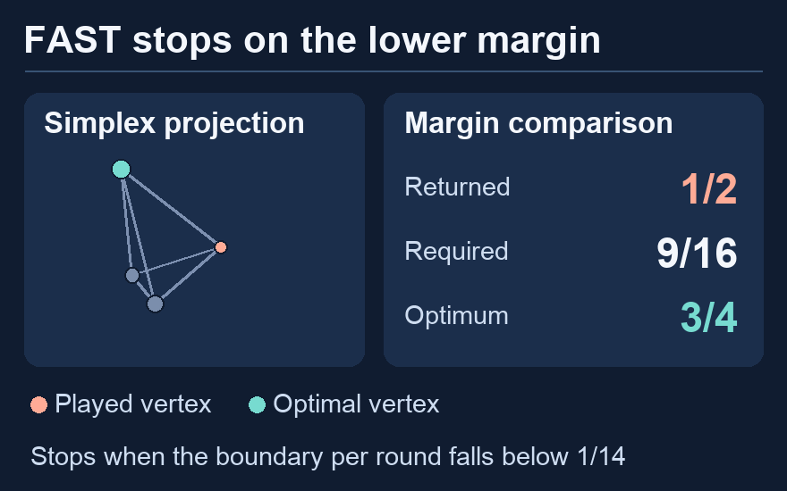

# Premature certification under fixed-radius FAST sampling

   

For every fixed positive spherical radius and fixed optimism parameter, FAST with its published stopping boundary can certify a suboptimal action with probability at least one quarter. The example uses noiseless feedback and one constraint.

[Read the paper](paper/manuscript.pdf) · [LaTeX source](paper/manuscript.tex) · [Original question](https://raw.githubusercontent.com/mlresearch/v267/main/assets/gangrade25a/gangrade25a.pdf#page=9) · [Version DOI](https://doi.org/10.5281/zenodo.24572903)

## Explore the proof in 3D

On the history that always plays e₁, the rule stops when its boundary per round is below 1/14. The returned vertex has true margin 1/2. An optimal vertex has margin 3/4, making the promised threshold 9/16. Vary the normalized boundary to see the strict comparison.

[Download the offline explorer](https://raw.githubusercontent.com/DannyExperiments/fixed-radius-fast-certificate/v1.0.0/visualization/simplex-certificate-explorer.zip) · [Explorer source](visualization/index.html) · [Worked example](proof/worked-certificate.md) · [GIF rendering source](visualization/render.py)

## Why the proof works

Once e₁ has been sampled, it has a ridge-score lead. For fixed sphere radius, high dimension makes the perturbation coordinates that could overcome this lead small. Along the repeated-action history the boundary shrinks relative to the feedback sum independently of dimension. The proof chooses a stopping horizon first and then a dimension and thin simplex so this history occurs with probability at least one quarter.

The result concerns the spherical recommendation with the unchanged FAST stopping boundary. The verified-optimism version of FAST and regret analyses of other samplers concern different hypotheses and objectives. [Primary-source comparison](audits/public_safe_reports/LITERATURE.md)

## Reproduce the checks

    python3 -I scripts/verify_repository.py
    python3 -I verification/src/replay.py

[Recorded replay](verification/results/replay.txt) · [Scope](CLAIM_SCOPE_AND_LIMITATIONS.md) · [Reproducibility](REPRODUCIBILITY.md) · [Research disclosure](AI_DISCLOSURE.md)

## Cite

DannyExperiments. *Premature certification under fixed-radius FAST sampling*. Version 1.0.0, 27 November 2026. [Version DOI](https://doi.org/10.5281/zenodo.24572903).
